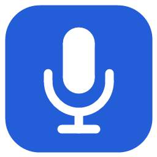

# Диктор



Локальная голосовая диктовка для Windows: нажмите горячую клавишу, произнесите текст и остановите запись. Диктор распознает речь на вашем компьютере, скопирует результат и при сохранении исходного поля отправит команду вставки.

**[Скачать Диктор для Windows x64](https://github.com/sinonhr-prog/dictor/releases/download/v0.1.0/Dictor-Portable-win-x64.zip)** · [Страница выпуска](https://github.com/sinonhr-prog/dictor/releases/tag/v0.1.0)

Предварительная версия **0.1.0**. Полная проверка на чистой Windows, с отключённой сетью и во всех сторонних редакторах ещё не завершена.

## Загрузка и первый запуск

1. Скачайте `Dictor-Portable-win-x64.zip` из раздела **Releases → Assets** (около 1,92 ГиБ). Архивы `Source code` предназначены для разработчиков и не содержат готового приложения.
2. Распакуйте **весь архив** в доступную для записи папку. Оставьте свободное место для архива и распакованного комплекта.
3. Откройте полученную папку и запустите **Диктор.exe**. Устанавливать .NET, Python или скачивать модели отдельно не требуется.
4. Дождитесь сообщения о готовности. Загрузка и прогрев модели могут занять некоторое время.
5. В настройках выберите микрофон. Проверка уровня включается отдельной кнопкой.

Требуется Windows x64 с микрофоном. Основной профиль использует видеокарту с работоспособным Vulkan-драйвером. Если модель не загрузилась, выберите профиль **CPU** в настройках и перезапустите приложение. Переключение на CPU выполняется вручную. Минимальные требования к RAM/VRAM пока не установлены испытаниями.

Сборка не подписана цифровым сертификатом. Не отключайте защиту Windows; сверяйте источник загрузки и контрольную сумму.

## Использование

1. Поставьте курсор в нужное текстовое поле.
2. Нажмите **Ctrl+Alt+Space** и говорите.
3. Нажмите сочетание повторно либо кнопку **«Стоп»**.
4. Дождитесь распознавания. Если исходное поле подтверждено, приложение отправит **Ctrl+V**. Клавиша Enter не нажимается.

**Esc** отменяет операцию. При переключении окна/поля или невозможности подтвердить цель текст остаётся в буфере: вставьте его вручную. Сообщение «Команда вставки отправлена» не гарантирует, что сторонний редактор принял текст. Если буфер занят, используйте **«Скопировать снова»** в меню значка возле часов.

В настройках доступны микрофон, горячая клавиша, профиль CPU/GPU, тема и параметры капсулы. Закрытие настроек оставляет Диктор работающим в трее. Для завершения выберите **«Выход»**. Длительность одной записи ограничена примерно 10 минутами.

Не переносите один EXE: приложению нужны остальные файлы, папки `models`, `runtimes` и `licenses`. Для удаления завершите приложение и удалите его папку. Для обновления распакуйте новый выпуск отдельно; личные настройки при необходимости перенесите из `data` после закрытия приложения.

## Приватность

Распознавание выполняется локально через Whisper.net / whisper.cpp и Silero VAD. В рабочий сценарий не встроены облачный ASR, телеметрия или автоматическая загрузка моделей. Аудио и последний результат хранятся в памяти, история диктовок на диск не записывается. Настройки создаются в `data/settings.json` рядом с приложением.

Текст помещается в системный буфер обмена. Если в Windows включены история или синхронизация буфера, они могут сохранять или передавать его независимо от Диктора. Сетевая изоляция приложения отдельным испытанием пока не подтверждена.

## Что входит в выпуск

- Приложение и среда .NET для Windows x64.
- Whisper large-v3-turbo F16 для Vulkan и small Q5_1 для CPU.
- Silero VAD для обнаружения речи.
- Лицензии зависимостей и `checksums.json` с контрольными суммами файлов.

Личные настройки, аудиозаписи, транскрипции, SDK и внутренние отчёты в публичный комплект не включены.

## Проверка загрузки

Рядом с ZIP в выпуске находится `Dictor-Portable-win-x64.zip.sha256`. В PowerShell выполните:

```powershell
Get-FileHash .\Dictor-Portable-win-x64.zip -Algorithm SHA256
```

Результат должен совпасть со значением в файле `.sha256`. Не запускайте неполный или повреждённый комплект.

## Проверки и ограничения

При подготовке версии прошли сборка, проверка форматирования и 13 автоматических тестов. Проверены целостность 516 файлов ZIP, запуск и штатный выход, загрузка CPU-модели и рендер интерфейса. Это не полная приёмка: совместимость произвольных редакторов, повышенных прав, нескольких мониторов, длительных сеансов и поведение на чистой Windows требуют дальнейших проверок. Качество распознавания зависит от речи, микрофона и выбранной модели; результат следует просматривать.

Если нашли ошибку, создайте [Issue](https://github.com/sinonhr-prog/dictor/issues) с версией Windows, профилем и шагами воспроизведения. Не прикладывайте личные записи, тексты, настройки или содержимое буфера.

## Исходники и зависимости

[Сборка из исходников](docs/BUILD.md) · [Описание выпуска](docs/RELEASE_NOTES.md) · [Сторонние компоненты и лицензии](THIRD_PARTY_NOTICES.md).

Исходники доступны публично. Отдельная лицензия на оригинальный код Диктора пока не объявлена; лицензии сторонних компонентов действуют на соответствующие компоненты.
